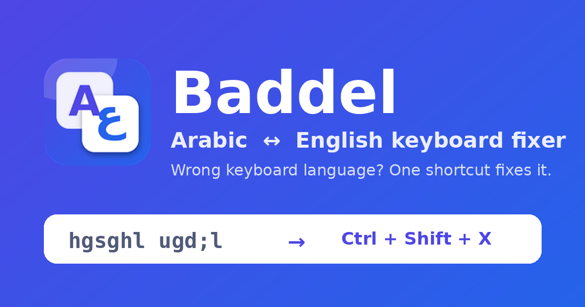
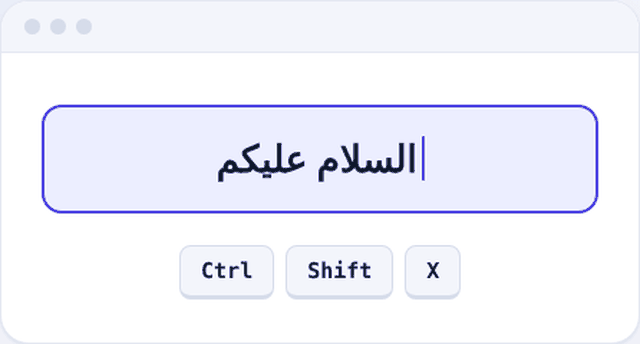

<div align="center">



[](https://github.com/shawady6/baddel/raw/main/docs/downloads/Baddel-Setup.exe)
[](https://github.com/shawady6/baddel/raw/main/docs/downloads/baddel.zip)
[](https://shawady6.github.io/baddel/)



</div>

<div dir="rtl" align="right">

## بدّل · Baddel

**كتبت عربي وانت على كيبورد إنجليزي؟ حدد الكلام واضغط `Ctrl+Shift+X`.**

| اللي اتكتب | بعد الضغط |
|:--|:--|
| `hgsghl ugd;l` | السلام عليكم |
| `اثممخ` | `hello` |

ضغطة تانية بترجّع الكلام زي ما كان. ولو مفيش تحديد، بيحوّل آخر كلمة.

### حمّل واشتغل

**🪟 نسخة الويندوز** (بتشتغل في أي برنامج حتى شريط العنوان)
1. [حمّل Baddel-Setup.exe](https://github.com/shawady6/baddel/raw/main/docs/downloads/Baddel-Setup.exe) وشغّله (أو [النسخة المحمولة](https://github.com/shawady6/baddel/raw/main/docs/downloads/baddel.exe) من غير تثبيت).
2. لو ويندوز طلّع تحذير: **More info ← Run anyway**.
3. دبل كليك على الأيقونة جنب الساعة للإعدادات.

**🧩 إضافة المتصفح** (Chrome وEdge وBrave وOpera)
1. [حمّل baddel.zip](https://github.com/shawady6/baddel/raw/main/docs/downloads/baddel.zip) وفك الضغط في فولدر ثابت.
2. افتح `chrome://extensions` (أو `edge://extensions`) وفعّل **Developer mode**.
3. دوس **Load unpacked** واختار الفولدر.

### ملحوظات

- الإضافة مش بتشتغل في شريط العنوان (المتصفح بيمنعها)، استخدم نسخة الويندوز.
- مفيش أي اتصال بالإنترنت ولا جمع بيانات. التفاصيل في [PRIVACY.md](PRIVACY.md).
- لو لقيت مشكلة: [بلّغ هنا](https://github.com/shawady6/baddel/issues).

</div>

---

## English

**Typed Arabic on an English keyboard (or the reverse)? Select the text and press `Ctrl+Shift+X`.**

Press it again to undo. With nothing selected, it converts the last word.

### Download

**🪟 Windows app** (works in any program, even the browser address bar)
1. [Download Baddel-Setup.exe](https://github.com/shawady6/baddel/raw/main/docs/downloads/Baddel-Setup.exe) and run it (or the [portable exe](https://github.com/shawady6/baddel/raw/main/docs/downloads/baddel.exe), no installation).
2. If Windows shows a warning: **More info → Run anyway** (the app isn't code-signed).
3. Double-click the tray icon for settings.

**🧩 Browser extension** (Chrome, Edge, Brave, Opera)
1. [Download baddel.zip](https://github.com/shawady6/baddel/raw/main/docs/downloads/baddel.zip) and extract it to a permanent folder.
2. Open `chrome://extensions` (or `edge://extensions`) and turn on **Developer mode**.
3. Click **Load unpacked** and choose the folder.

### Notes

- The extension can't work in the address bar (browsers block it); use the Windows app there.
- No network access, no data collection. See [PRIVACY.md](PRIVACY.md).
- Found a problem? [Open an issue](https://github.com/shawady6/baddel/issues).

---

<details>
<summary>For developers</summary>

```text
extension/   browser extension (load unpacked)
desktop/     Windows app (AutoHotkey v2) - see desktop/windows/README.md
docs/        website (GitHub Pages) and the downloads
scripts/     release.py (builds zips), gen_ahk.js (conversion tables)
tests/       node tests/test_logic.js
```

`docs/downloads/baddel.exe` is built on Windows (right-click `baddel.ahk` → Compile script) and must be replaced whenever `baddel.ahk` changes. Release: bump `extension/manifest.json`, run `python3 scripts/release.py` and `node tests/test_logic.js`, commit, push.

</details>

[MIT](LICENSE) © Ibrahim
