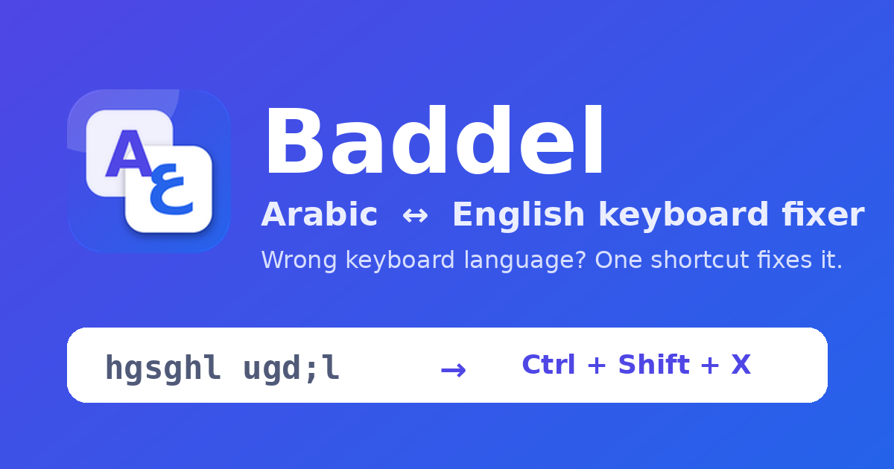
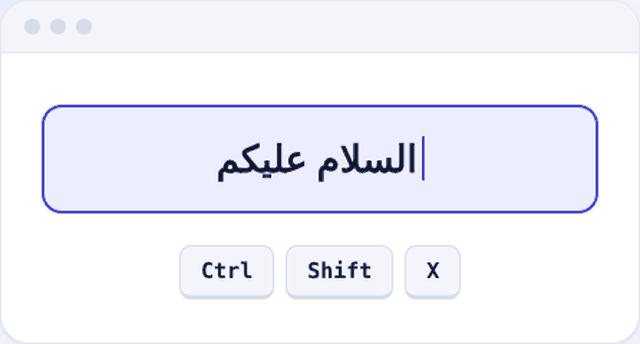

<div align="center">



[](https://github.com/shawady6/baddel/raw/main/docs/downloads/rust/Baddel-Setup.exe)
[](https://shawady6.github.io/baddel/)



</div>

<div dir="rtl" align="right">

## بدّل · Baddel

**كتبت عربي وانت على كيبورد إنجليزي؟ اضغط `Ctrl+Shift+X` والكلام يتصلّح.**

برنامج ويندوز صغير وسريع (مكتوب بـ Rust) بيشتغل في أي برنامج: وورد، المتصفح، الشات، حتى شريط العنوان.

| اللي اتكتب | بعد الضغط |
|:--|:--|
| `hgsghl ugd;l` | السلام عليكم |
| `اثممخ` | `hello` |

### بيعمل إيه

- **بيحوّل الاتجاهين** عربي ← إنجليزي وإنجليزي ← عربي، وفي الوضع التلقائي كل كلمة بتتحوّل حسب لغتها.
- **من غير تحديد:** بيحوّل آخر كلمة، أو آخر كلمات كتبتها بنفس اللغة.
- **تراجع:** ضغطة تانية بترجّع الكلام زي ما كان.
- **اختصار بتختاره:** اضغط الأزرار اللي عاوزها في الإعدادات وهتتسجل (Ctrl وAlt وShift وWin).
- **اختياري:** يبدّل لغة الكيبورد بعد التحويل، ويفتح مع ويندوز.
- **بيحافظ على الكليب بورد** بتاعك زي ما كان.

### التحميل

1. [حمّل Baddel-Setup.exe](https://github.com/shawady6/baddel/raw/main/docs/downloads/rust/Baddel-Setup.exe) وشغّله.
2. لو ويندوز طلّع تحذير: **More info ← Run anyway** (البرنامج لسه من غير توقيع رقمي).
3. دبل كليك على الأيقونة جنب الساعة للإعدادات.

ولو عاوزه من غير تثبيت: [baddel.exe](https://github.com/shawady6/baddel/raw/main/docs/downloads/rust/baddel.exe) بيشتغل مباشرة.

### ملحوظات

- مفيش أي اتصال بالإنترنت ولا جمع بيانات. التفاصيل في [PRIVACY.md](PRIVACY.md).
- بعض برامج مكافحة الفيروسات بتشك في أي برنامج بيحاكي الكيبورد. الكود مفتوح وتقدر تراجعه.
- لو لقيت مشكلة: [بلّغ هنا](https://github.com/shawady6/baddel/issues).

</div>

---

## English

**Typed Arabic on an English keyboard (or the reverse)? Press `Ctrl+Shift+X` and it's fixed.**

A small, fast Windows app (written in Rust) that works in any program: Word, browsers, chat apps, even the address bar.

### Features

- **Both directions**, Arabic → English and English → Arabic. In Auto mode each word is converted by its own language.
- **Nothing selected?** It converts the last word, or the last words you typed in the same language.
- **Undo:** press the shortcut again to put the text back.
- **Your own shortcut:** press the keys you want in Settings and they are recorded (Ctrl, Alt, Shift, Win).
- **Optional:** switch the keyboard language after converting, start with Windows.
- **Your clipboard is restored** after every conversion.

### Download

1. [Download Baddel-Setup.exe](https://github.com/shawady6/baddel/raw/main/docs/downloads/rust/Baddel-Setup.exe) and run it.
2. If Windows shows a warning: **More info → Run anyway** (the app isn't code-signed yet).
3. Double-click the tray icon for settings.

No install needed? [baddel.exe](https://github.com/shawady6/baddel/raw/main/docs/downloads/rust/baddel.exe) runs on its own.

### Notes

- No network access, no data collection. See [PRIVACY.md](PRIVACY.md).
- Some antivirus tools distrust any program that simulates keystrokes. The code is open for you to review.
- Found a problem? [Open an issue](https://github.com/shawady6/baddel/issues).

---

<details>
<summary>For developers</summary>

```text
desktop/rust/   the app (Rust, Win32): src/core.rs is the platform-independent logic
docs/           website (GitHub Pages) and the downloads
scripts/        gen_rust.js generates the conversion tables
tests/          node tests/test_logic.js
```

```bash
cd desktop/rust && cargo test        # logic tests run on any OS
```

The Windows build and installer are produced by `.github/workflows/windows.yml` (run it with `publish=true` to commit the build to `docs/downloads/rust/`).

</details>

[MIT](LICENSE) © Ibrahim
