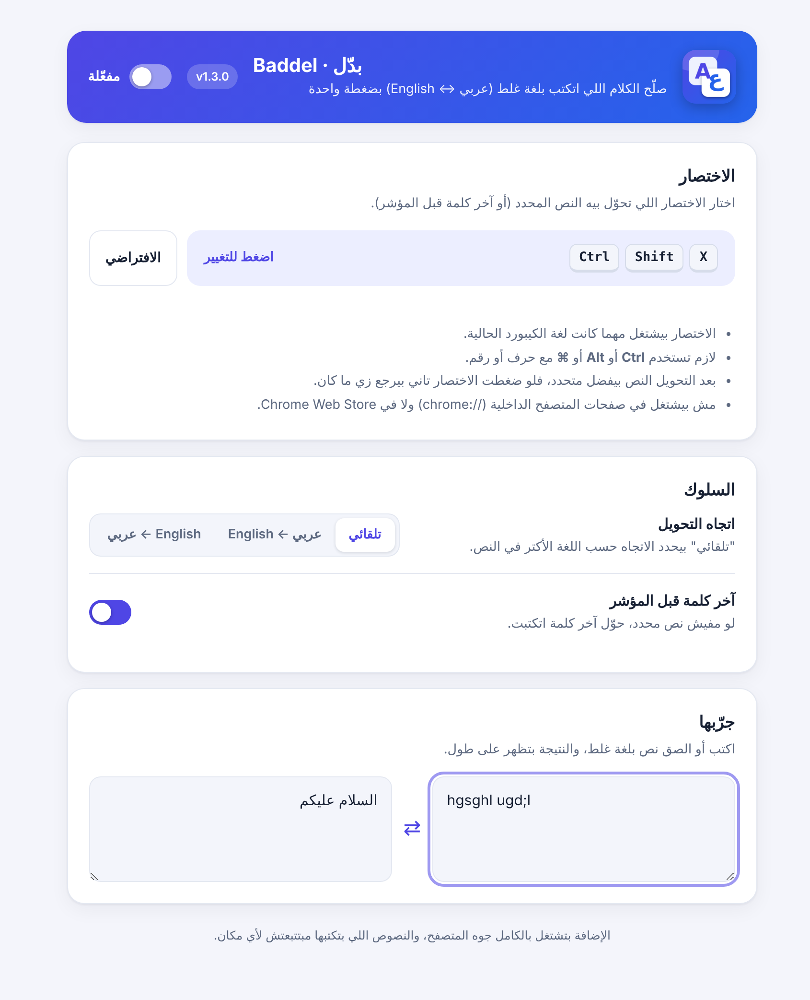
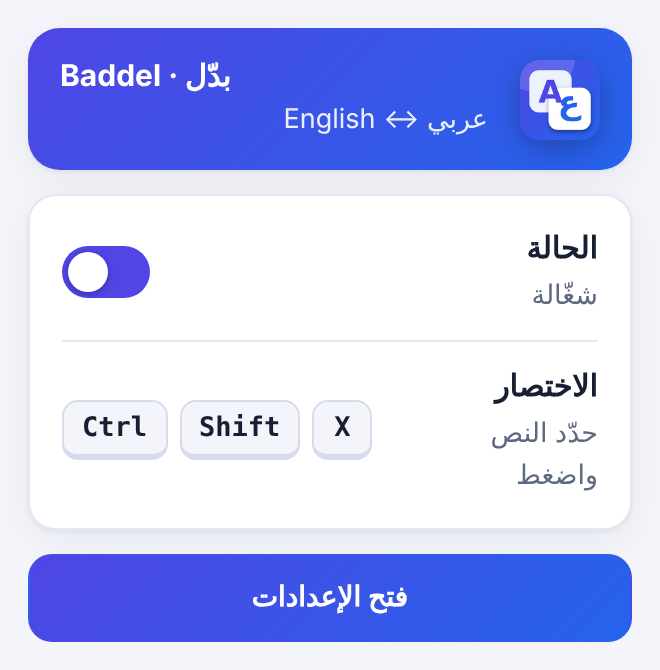

<div align="center">


<br>

[](https://github.com/shawady6/baddel/raw/main/docs/downloads/baddel.zip)
[](https://github.com/shawady6/baddel/raw/main/docs/downloads/baddel-windows.zip)
[](https://shawady6.github.io/baddel/)


[](LICENSE)

**[العربية](#arabic) · [English](#english) · [Website / الموقع](https://shawady6.github.io/baddel/) · [Privacy](PRIVACY.md)**

<br>


</div>

---

<a name="arabic"></a>

<div dir="rtl" align="right">

## بدّل · Baddel

**كتبت عربي وانت على كيبورد إنجليزي؟ بدّل بضغطة.**

إضافة مجانية ومفتوحة المصدر لمتصفحات Chromium (Chrome وEdge وBrave وOpera) بتحوّل الكلام اللي اتكتب بلغة الكيبورد الغلط بين العربي والإنجليزي، من غير ما تمسح وتكتب من الأول.

| اللي اتكتب | بعد الضغط |
|:--|:--|
| `hgsghl ugd;l` | السلام عليكم |
| `lvpfh` | مرحبا |
| `اثممخ` | `hello` |

### المميزات

- **اختصار واحد** (الافتراضي `Ctrl+Shift+X`) بيحوّل النص المحدد، أو آخر كلمة قبل المؤشر لو مفيش تحديد.
- **تراجع بنفس الضغطة:** بعد التحويل النص بيفضل متحدد، وضغطة تانية بترجّعه زي ما كان.
- **بيشتغل مهما كانت لغة الكيبورد الحالية،** لأن الاختصار بيعتمد على مفتاح الكيبورد نفسه.
- **صفحة إعدادات:** تسجيل اختصار جديد، واتجاه التحويل (تلقائي أو عربي ← English أو العكس)، وتشغيل وإيقاف، وصندوق تجربة مباشر.
- **خصوصية كاملة:** مفيش أي طلبات شبكة ولا جمع بيانات. الكود قدامك وتقدر تراجعه.

### الشكل

<table>
<tr>
<td align="center"><br><sub>صفحة الإعدادات</sub></td>
<td align="center"><br><sub>النافذة المنبثقة</sub></td>
</tr>
</table>

### التثبيت

الإضافة لسه مش على متجر Chrome، فبتتثبّت يدويا في دقيقتين:

1. **[حمّل baddel.zip](https://github.com/shawady6/baddel/raw/main/docs/downloads/baddel.zip)** وفك ضغطه في مكان ثابت (المتصفح بيقرا الإضافة من الفولدر ده، فمتمسحوش).
2. افتح `chrome://extensions` (أو `edge://extensions`) وفعّل **Developer mode** من فوق على اليمين.
3. دوس **Load unpacked** واختار فولدر `baddel`.
4. ثبّت الأيقونة من قايمة الإضافات 🧩.

> شرح بالصور وزرار نسخ الرابط على [الموقع](https://shawady6.github.io/baddel/#install).

### الاستخدام

1. اكتب أي حاجة في أي خانة نص، وحدد الكلام اللي اتكتب غلط.
2. اضغط **`Ctrl+Shift+X`**.
3. لو مفيش تحديد، هيحوّل آخر كلمة قبل المؤشر.

لتغيير الاختصار: دوس على أيقونة الإضافة ← **فتح الإعدادات** ← دوس على خانة الاختصار واضغط المجموعة الجديدة.

### نسخة الويندوز (بتشتغل في أي برنامج)

لو عاوز التحويل **في أي برنامج حتى شريط العنوان**، فيه برنامج صغير للويندوز بيقعد جنب الساعة وبيشتغل بنفس الاختصار:
[**حمّل baddel-windows.zip**](https://github.com/shawady6/baddel/raw/main/docs/downloads/baddel-windows.zip)، وثبّت [AutoHotkey v2](https://www.autohotkey.com) (مجاني)، ودبل كليك على `baddel.ahk`. التفاصيل في [desktop/windows](desktop/windows/README.md).

### حدود لازم تعرفها

- مش بيشتغل في صفحات `chrome://` ولا Chrome Web Store ولا محررات الكانفس زي Google Docs ولا خانات الإيميل والباسورد.
- **مش بيشتغل في شريط العنوان** (اللي فوق في المتصفح)، لأنه جزء من واجهة المتصفح نفسه مش من الصفحة، والمتصفحات بتمنع الإضافات منه. الحل: استخدم **نسخة الويندوز** فوق، أو اكتب في أي خانة جوه صفحة (زي سيرش جوجل)، أو حوّل الكلام في خانة تانية وبعدين قصّه والصقه في الشريط.
- الخريطة بين لوحة Arabic 101 ولوحة US QWERTY. الرموز النادرة مع Shift ممكن تحتاج مراجعة بعد التحويل.
- في اتجاه عربي ← English، الحرفين «لا» بيتحولوا لـ `gh` (ل + ا) لأن نفس الحروف بتيجي من مفتاحين منفصلين.

</div>

---

<a name="english"></a>

## English

**Typed Arabic on an English keyboard (or the other way round)? Fix it in one keypress.**

Baddel is a free, open-source extension for Chromium browsers (Chrome, Edge, Brave, Opera) that converts text typed in the wrong keyboard layout between Arabic and English, so you never have to delete and retype.

| You typed | After the shortcut |
|:--|:--|
| `hgsghl ugd;l` | السلام عليكم |
| `lvpfh` | مرحبا |
| `اثممخ` | `hello` |

### Features

- **One shortcut** (default `Ctrl+Shift+X`) converts the selection, or the word before the caret when nothing is selected.
- **Undo with the same key:** the result stays selected, so pressing the shortcut again flips it back.
- **Layout independent:** the shortcut is matched by physical key, so it works whichever language is active.
- **Settings page:** shortcut recorder, conversion direction (auto, Arabic→English, English→Arabic), on/off switch and a live preview.
- **Private by design:** no network requests, no analytics, no data collection. Read the code yourself.

### Install (manual)

Baddel isn't on the Chrome Web Store yet, so it takes about two minutes to install:

1. **[Download baddel.zip](https://github.com/shawady6/baddel/raw/main/docs/downloads/baddel.zip)** and extract it somewhere permanent (the browser loads the extension from that folder, so don't delete it).
2. Open `chrome://extensions` (or `edge://extensions`) and switch on **Developer mode**.
3. Click **Load unpacked** and choose the `baddel` folder.
4. Pin the icon from the puzzle 🧩 menu.

> A step-by-step guide with a copy button for the address is on the [website](https://shawady6.github.io/baddel/#install).

### Usage

1. Type in any text field, then select the text you typed in the wrong language.
2. Press **`Ctrl+Shift+X`**.
3. With nothing selected, the word before the caret is converted.

To change the shortcut: click the extension icon → **Open settings** → click the shortcut box and press the new combination.

### Windows app (works in any program)

Want it **everywhere, including the browser address bar**? There's a small Windows tray app with the same shortcut:
[**Download baddel-windows.zip**](https://github.com/shawady6/baddel/raw/main/docs/downloads/baddel-windows.zip), install [AutoHotkey v2](https://www.autohotkey.com) (free) and double-click `baddel.ahk`. Details in [desktop/windows](desktop/windows/README.md).

### Limitations

- Doesn't run on `chrome://` pages, the Chrome Web Store, canvas editors such as Google Docs, or email/password fields.
- **Doesn't work in the browser's address bar (omnibox).** It's part of the browser's own UI rather than a web page, and browsers don't let extensions touch it. Workaround: use the **Windows app** above, or type into any text field on a page (such as the Google search box), or convert the text in another field, then cut and paste it into the address bar.
- The map is Arabic 101 ↔ US QWERTY. Rare shifted symbols may deserve a quick check after converting.
- In the Arabic→English direction the lam-alef `لا` becomes `gh` (ل + ا), because the same characters can come from two separate keys.

### Roadmap

- [ ] Microsoft Edge Add-ons listing
- [ ] Chrome Web Store listing
- [ ] Firefox build
- [ ] More keyboard layouts (Arabic 102, French AZERTY)

Ideas and bug reports are welcome in [Issues](https://github.com/shawady6/baddel/issues).

### Permissions, explained

| Permission | Why it's needed |
|:--|:--|
| Access to all sites | To listen for the shortcut and edit the text field you're typing in, on any website. Nothing happens until you press the shortcut. |
| `storage` | To save your settings (shortcut, direction, on/off). |
| `scripting` | To attach to tabs that were already open when the extension was installed. |

Full details in [PRIVACY.md](PRIVACY.md).

---

## Development

```text
extension/   the browser extension — load this folder unpacked
desktop/     the Windows tray app (AutoHotkey v2)
docs/        the website (GitHub Pages, served from /docs) and the download
scripts/     release.py → builds the zips in dist/ and docs/downloads/; gen_ahk.js → conversion tables for the Windows app
tests/       node tests for the conversion map, shortcut logic and packaging
```

```bash
node tests/test_logic.js      # run the tests
python3 scripts/release.py    # build the zip and sync docs/shared.js
```

`docs/shared.js` is a copy of `extension/shared.js` so the website demo uses exactly the same conversion map. `release.py` keeps them in sync and the tests fail if they differ.

**Releasing a new version:** bump `version` in `extension/manifest.json`, run `python3 scripts/release.py` and `node tests/test_logic.js`, then commit and push. The website's download button serves `docs/downloads/baddel.zip`.

## License

[MIT](LICENSE) © Ibrahim
